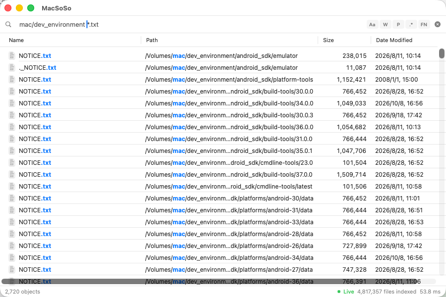

<p align="center">
  
</p>

<h1 align="center">MacSoSo</h1>

<p align="center">
  <b>macOS 极速文件搜索工具</b> — 在数百万文件中毫秒级定位任意文件。<br/>
  灵感源自 Windows 上的 <a href="https://www.voidtools.com/">Everything</a>，Mac 上无出其右。
</p>

<p align="center">
  <b>中文</b> | <a href="README_EN.md">English</a>
</p>

<p align="center">
  <a href="#安装"></a>
  <a href="LICENSE"></a>
  <a href="#测试体系"></a>
  <a href="#ai-工具集成-mcp"></a>
</p>

---

<p align="center">
  <br/>
  <sub>界面截图摄于更名前；当前版本窗口标题已改为 MacSoSo。</sub>
</p>

## 与上游项目的关系

> **命名说明**：本项目现名为 **MacSoSo**（2026-10 由 MacEverything 改名）。
> 上游项目仍名为 MacEverything，下述署名与链接保持不变。

本项目**改编自 [joshua-wu/MacEverything](https://github.com/joshua-wu/MacEverything)**
（基线提交 `26f0332`，MIT 许可证）。上游项目启发了本项目的引擎与界面；
本仓库在其基础上完成了 Everything 搜索语义、Everything 风格界面、外置卷
索引与发布流程的改造。

- 完整改动说明：[docs/CHANGES_FROM_UPSTREAM.md](docs/CHANGES_FROM_UPSTREAM.md)
- 改编与版权声明：[NOTICE](NOTICE)
- 本项目与 voidtools 无隶属关系；"Everything" 仅用于说明搜索语法兼容性。

## 功能亮点

### 极速搜索

索引整块磁盘 **500 万+ 文件只需 14 秒**，之后每次搜索 **不到 5ms** 返回结果。比 Spotlight 快两个数量级。

| 对比项 | MacSoSo | Spotlight | `find` |
|--------|:---:|:---:|:---:|
| 索引 500 万文件 | ~14 秒 | 数分钟以上 | 无索引 |
| 搜索延迟 | **< 5ms** | 200ms–2s | 5–30s |
| 实时文件监控 | FSEvents | FSEvents | 无 |
| 内容搜索 | Trigram 索引 | 侧重元数据 | `grep` |
| AI 工具集成 | 内置 MCP | 不支持 | 不支持 |

### 随叫随到

按 **`Option+Space`** 随时唤出搜索窗口（快捷键可自定义），搜索栏自动获得焦点 — 唤起即输入，搜完即走。支持开机自启（最小化后台运行），不打扰你的工作流。

### 智能输入体验

- **Ghost 文本自动补全** — 输入时自动显示半透明建议文字，来自搜索历史（按频率排序）或系统关键词（如输入 `ex` 提示 `ext:`）。按 **Tab** 一键接受
- **搜索栏语法高亮** — 实时彩色标注：过滤器名紫色、参数蓝色、引号字符串橙色、运算符红色
- **常驻搜索选项** — 搜索栏右侧始终显示 `Aa` / `W` / `P` / `.*` / `FN` 开关，激活时高亮，点击即可切换 Match Case / Whole Word / Match Path / Regex / Match Filename

### Everything 风格界面

主窗口的布局与操作方式对齐 Everything：

- **四列表格** — Name / Path / Size / Date Modified，默认紧凑行高；点击列标题切换升/降序，并同步为查询中的 `sort:` 修饰符，由引擎在截断前完成排序
- **扁平工具栏** — 顶部只有搜索框与常驻选项开关，没有分页或额外横幅；结果表格自适应窗口、虚拟化渲染
- **底部状态栏** — 左侧显示结果对象数与选中数量，右侧显示内容索引进度、实时监控状态、索引文件总数与查询耗时
- **行操作** — 双击打开；右键菜单提供打开 / 在 Finder 中显示 / 复制完整路径；支持从结果行直接拖放到其他应用

### Everything 风格查询语法

完整的 AST 解析器，语义与 voidtools Everything 保持一致：默认按文件名匹配，含 `/` 的词按全路径匹配，`|` 为 OR（优先于 AND 求值），`< >` 分组，`!` 取反。内置语法帮助窗口（**Cmd+?**）。

| 查询 | 说明 |
|------|------|
| `readme` | 文件名包含 "readme" |
| `*.swift` | 所有 Swift 源文件（`*` 不跨目录） |
| `src/**/*.swift` | 任意层级的 Swift 文件（`**` 跨目录） |
| `ext:py size:>1mb` | 大于 1MB 的 Python 文件 |
| `dm:today` | 今天修改过的文件 |
| `config path:/usr` | 全路径含 `/usr` 且名称含 "config" 的文件 |
| `"exact phrase"` | 精确短语匹配 |
| `foo \| bar` | 布尔 OR（OR 先于 AND 求值） |
| `<foo \| bar> baz` | 尖括号分组 |
| `!foo` | 布尔 NOT |
| `location:Downloads` | 位于 Downloads 文件夹内 |
| `parent:/Users/me` | 父目录恰好是 `/Users/me` |
| `case:Makefile` | 区分大小写搜索 |
| `case:regex:^test_` | 修饰符可叠加 |
| `regex:^test_.*\.py$` | 正则表达式搜索 |
| `type:folder node_modules` | 仅搜索目录 |
| `~/Documents/*.pdf` | Tilde 展开 + glob（仅直接子项） |
| `infile:TODO ext:cpp` | C++ 文件中搜索 "TODO" |
| `ext:cpp sort:-size` | 按大小降序排列结果 |
| `sort:size;name` | 先按大小、再按名称排序 |
| `dupe:` | 查找重复文件 |
| `empty:` | 查找没有子项的空文件夹 |

> `AND` / `OR` / `NOT` 关键字和圆括号在 Everything 中是普通文本，请使用空格、`|`、`!` 与 `< >`。

<details>
<summary><b>全部过滤器列表</b></summary>

| 过滤器 | 说明 | 示例 |
|--------|------|------|
| `ext:` | 文件扩展名 | `ext:swift,h`（支持 `;` `,` `\|`） |
| `noext:` | 排除扩展名 | `noext:tmp,log` |
| `size:` / `fs:` | 文件大小 | `size:>1mb`, `size:100kb-5mb` |
| `type:` | 文件/目录/媒体类型 | `type:folder`, `type:image` |
| `path:` | 全路径（含文件名）包含 | `path:Downloads` |
| `location:` / `loc:` | 仅父目录路径包含 | `location:Downloads` |
| `full-path:` | 全路径（同 `path:`） | `full-path:/usr/local` |
| `nopath:` | 全路径排除 | `nopath:node_modules` |
| `parent:` | 父目录完全匹配（绝对路径） | `parent:/Users/me/src` |
| `parent-name:` | 父目录名包含 | `parent-name:local` |
| `ancestor:` | 位于指定目录之下 | `ancestor:/Users/me/src` |
| `ancestor-name:` | 任一祖先目录名包含 | `ancestor-name:node_modules` |
| `depth:` | 目录深度 | `depth:<3` |
| `len:` / `name-length:` | 文件名长度 | `len:>50` |
| `full-path-length:` | 全路径长度 | `fullpathlen:>100` |
| `dm:` | 修改日期 | `dm:today`, `dm:>2024-01-01` |
| `dc:` | 创建日期 | `dc:thisweek` |
| `da:` | 访问日期 | `da:last7days` |
| `fn:` | 完整文件名匹配 | `fn:Makefile` |
| `fu:` | 完整路径匹配 | `fu:/usr/bin/ls` |
| `case:` | 区分大小写 | `case:README` |
| `regex:` | 正则表达式 | `regex:^test_` |
| `ww:` | 全词匹配 | `ww:test` |
| `wfn:` | 全文件名匹配 | `wfn:Makefile` |
| `empty:` | 无子项的空文件夹 | `empty:` |
| `childcount:` | 子项数量 | `childcount:0` |
| `child:` | 包含指定子项 | `child:readme` |
| `dupe:` | 重复文件 | `dupe:name;size` |
| `dupe-min:` / `dupe-max:` | 重复组数量下限/上限 | `dupe-min:3` |
| `dupe-count:` | 每组最多显示条数 | `dupe:size dupe-count:2` |
| `dupe-from:` | 组内含指定文件夹中的项（含子目录） | `dupe:size dupe-from:~/Photos` |
| `content:` / `infile:` | 内容搜索 | `infile:TODO` |
| `sort:` / `sorted:` | 结果排序 | `sort:size-descending` |
| `audio:` `video:` `pic:` `doc:` `zip:` `image:` `archive:` | 文件类型宏 | `audio:` = 所有音频文件 |

**排序（`sort:`）** — 字段名与 Everything 的列名一致，用 `;` 分隔多个排序列：

| 写法 | 含义 |
|------|------|
| `sort:name` | 按名称升序 |
| `sort:-size` | 按大小降序（前导减号） |
| `sort:size-descending` | 按大小降序（后缀形式） |
| `sort:dm:descending` | 修改时间从新到旧 |
| `sort:size;name` | 先大小、后名称（多列排序） |
| `sort:name;size-descending` | 每列可单独指定方向 |
| `folders-first:` | 文件夹排在文件之前（截断前生效） |

可用字段：`name` `path` `size` `ext` `type` `dm` `dc` `da` `depth` `len`。
未指定 `sort:` 时保持相关度排序（完全匹配 > 前缀匹配 > 包含匹配）。

</details>

### 全文内容搜索

输入 `infile:关键词` 搜索文件内容，结果附带关键词高亮上下文片段。基于 Trigram 索引加速，仅重新索引变更文件。可在「内容设置」中配置索引的文件类型和最大文件大小。

### 实时同步，永不过时

- **文件监控** — 基于 FSEvents 实时监听文件系统变更，新建、重命名、删除的文件立即出现在搜索结果中
- **两阶段即时启动** — 启动时先加载磁盘缓存（立即可搜），后台通过 FSEvents 增量追赶变更，搜索零等待
- **焦点感知省电** — 窗口不在前台时暂停刷新，回到前台时批量追赶，几乎零后台 CPU 占用

### 交互细节

- **智能高亮** — 搜索结果中匹配部分高亮标记，基于 AST 感知：正确处理 glob 通配符、正则、大小写、NOT 排除等复杂场景
- **拖放** — 直接从搜索结果拖放文件到 Finder、VS Code、Xcode 等任意应用
- **右键菜单** — 打开 / 在 Finder 中显示 / 复制完整路径
- **Cmd+Click** — 快速在 Finder 中定位文件
- **最近文件** — 搜索栏为空时自动展示最近修改的文件（Everything 风格结果表格）

### AI 工具集成 (MCP)

内置 [Model Context Protocol](https://modelcontextprotocol.io/) 服务器，让 AI 编程工具即时搜索你的文件系统。在菜单栏一键开启，支持 **Claude Code**、**Cursor**、**Claude Desktop**。

```
Claude Code / Cursor / Claude Desktop
       │
       ▼  (stdio JSON-RPC 2.0)
  MacSoSoMCP
       │
       ▼  (HTTP localhost:19860)
  MacSoSo.app
```

| 工具 | 说明 |
|------|------|
| `search_files` | 文件名搜索（Trigram 加速） |
| `search_content` | 全文内容搜索 |
| `recent_files` | 最近修改的文件 |
| `index_status` | 索引统计与健康状态 |

### HTTP API

本地 REST API 监听 `localhost:19860`，方便脚本调用和自动化：

```bash
curl "http://localhost:19860/api/search?q=readme&limit=10"       # 搜索文件
curl "http://localhost:19860/api/search?q=ext:cpp&sort=-size"     # 搜索并按大小降序
curl "http://localhost:19860/api/search/content?q=TODO"           # 内容搜索
curl "http://localhost:19860/api/recent?limit=20"                 # 最近文件
curl "http://localhost:19860/api/status"                          # 索引状态
```

`/api/search` 的参数：

| 参数 | 默认 | 说明 |
|------|------|------|
| `q` | 必填 | 查询表达式，支持完整 Everything 语法 |
| `limit` | 100 | 结果上限（最大 10000） |
| `trigram` | 1 | 设为 `0` 关闭三元组加速 |
| `sort` | 空 | Everything 风格排序，如 `name`、`size-descending` |

`q` 以 `infile:` 或 `content:` 开头时会自动转交内容搜索。

### 安装

#### 下载 DMG（推荐）

1. 从 [Releases](../../releases) 下载对应架构的
   `MacSoSo-<版本>-arm64.dmg`（Apple Silicon）或
   `MacSoSo-<版本>-x86_64.dmg`（Intel）
2. 将 `MacSoSo.app` 拖入「应用程序」文件夹
3. 首次启动如被 Gatekeeper 拦截，右键 App →「打开」，或执行
   `xattr -dr com.apple.quarantine /Applications/MacSoSo.app`
4. 启动后按提示授予 **完全磁盘访问权限**
5. 等待初始扫描完成（首次扫描包含 `/Volumes` 下的本地外置卷）
6. 按 `Option+Space` 开始搜索

> 当前 Release 默认使用 ad-hoc 签名，未做 Apple 公证。若需无警告分发，
> 请配置 Developer ID 证书并执行公证（见 [发布流程](docs/RELEASE.md)）。

#### 从源码构建

**环境要求：** macOS 14+，Xcode 15+，Homebrew 的 `re2` 与 `abseil`

```bash
brew install re2 abseil
git clone https://github.com/mylogo1024/MacSoso.git && cd MacSoso

# 构建并打包（自动内嵌 re2/abseil 动态库、生成 DMG 与 SHA256）
./scripts/package_release.sh --arch arm64
# Intel 机器使用：--arch x86_64
```

只构建 App 而不打包：`make app`。

#### CLI 守护进程

无头模式，适用于服务器或自动化环境：

```bash
make daemon
./macsoso-daemon --port 19860 --root /
```

---

<h2 align="center">开发者篇：技术深度</h2>

<p align="center">
  以下内容面向对实现细节感兴趣的开发者。
</p>

### 架构总览

```
┌─────────────────────────────────────┐
│       SwiftUI 应用层                │  界面 · ViewModel · MVVM
├─────────────────────────────────────┤
│    Objective-C++ 桥接层             │  零开销互操作
├─────────────────────────────────────┤
│       C++20 核心引擎                │  扫盘 · 索引 · 搜索 · 持久化
└─────────────────────────────────────┘
```

同一套 C++20 核心引擎驱动三种部署模式：

| 模式 | 说明 |
|------|------|
| **GUI 应用** | SwiftUI 菜单栏应用，`Option+Space` 全局快捷键 |
| **CLI 守护进程** | 无头 `macsoso-daemon` — 相同引擎，无 UI |
| **MCP 服务器** | `MacSoSoMCP` — stdio JSON-RPC 代理，供 AI 工具调用 |

### 核心引擎

| 组件 | 关键设计 |
|------|---------|
| **DirectoryScanner** | 多线程工作窃取 + `getattrlistbulk` 单次系统调用批量获取文件属性，4–32 线程自适应 |
| **SearchEngine** | Trigram 倒排索引（name + path 双索引）+ 竞争选择最优候选集 + SoA 列式过滤 |
| **ContentIndex** | Trigram 全文倒排索引，FNV-1a 哈希增量更新，仅重新索引变更文件 |
| **SIMDSearch** | ARM NEON 128-bit first-last byte 向量化匹配 + 2x 循环展开，单线程 11.5 GB/s |
| **IndexPersistence** | WAL + CRC32 + 分页脏页刷写 + 原子 rename，COW 无阻塞压缩（锁持有 < 100ms） |
| **FileSystemWatcher** | FSEvents + eventId 增量回放 + 日志截断检测自动子树重扫 |
| **PathTable** | 路径字符串 intern 化 — 目录路径仅存 `uint32` 索引，百万文件节省 ~550MB |
| **QueryParser** | 完整 AST 管线：Tokenizer → FilterParser → Parser → QueryAST，30+ 过滤器关键词 |

### 基准测试

测试环境：macOS Darwin 24.3.0，**540 万索引文件**，48 种查询类型：

#### 搜索延迟

| 查询类型 | 平均延迟 | 示例 |
|----------|:---------:|------|
| 长关键词 (7+ 字符) | **0.1–1ms** | `screenshot` 0.1ms, `dockerfile` 0.1ms |
| 中等关键词 (4–6 字符) | **1–5ms** | `readme` 1.2ms, `config` 4.7ms |
| Glob 模式 | **0.7–18ms** | `*.cpp` 0.7ms, `*.swift` 1.5ms |
| 路径查询 | **3–32ms** | `package.json` 2.9ms |
| 全部 48 种查询 (均值) | **10.5ms** | SoA 优化后最新结果 |

#### Trigram vs 线性扫描

| 查询 | Trigram | 线性扫描 | 加速比 |
|------|:------:|:------:|:------:|
| `node_modules` | 0.5ms | 154ms | **308x** |
| `application` | 2.1ms | 175ms | **83x** |
| `readme` | 1.2ms | 49ms | **41x** |

#### SIMD 字符串搜索 (Apple M3 Pro)

| 方法 | 吞吐量 | 对比 `std::string::find` |
|------|:------:|:------------------------:|
| `std::string::find` | 1.2 GB/s | 基准线 |
| **NEON 128-bit（单线程）** | **11.5 GB/s** | **9.5x** |
| **NEON 128-bit（12 线程）** | **74.3 GB/s** | **60.7x** |

### 关键技术

| 技术 | 效果 |
|------|------|
| `getattrlistbulk` | 单次系统调用批量获取文件属性 — 避免逐文件 `stat` |
| Trigram 倒排索引 | 亚线性搜索：比线性扫描快 33x–308x |
| SoA 列式布局 | 缓存友好的内存访问模式，纯过滤查询 SIMD 批量判断 16 条记录 |
| 并行索引构建 | Phase 2 后建索引按记录区间分片、GCD 并行、拼接合并；三元组索引快 2.4–3.6x |
| 零分配三元组提取 | 索引构建期消除逐记录临时 `std::string`（百万级文件省去千万次分配） |
| `__builtin_prefetch` | 预取距离 8，隐藏候选验证阶段的随机内存访问延迟 |
| ARM NEON SIMD | 128-bit 向量化字符串匹配，2x 循环展开，逼近内存带宽上限 |
| GCD 并行扫描 | Trigram 无法加速时启用多核线性扫描 |
| StringPool 连续内存 | 文件名紧凑排列在单一 `char` 缓冲区，SIMD 友好 |
| PathTable intern 化 | 目录路径仅存 `uint32` 索引 — 百万文件节省 ~550MB |
| Generation 计数器 | 每 1024 次迭代检查，快速输入时零开销取消过时查询 |
| APFS Firmlink 去重 | inode + devid 检测，正确处理 macOS Data/System 卷合并环路 |
| Regex Trigram 预过滤 | 从正则中提取字面量生成 trigram 候选，~7s → <100ms |
| 自适应 Trigram 旁路 | 候选集过大时自动回退并行扫描，避免无效索引查找 |
| 索引加载预读 | `F_RDADVISE` 提前通知内核预取各 section，降低冷缓存加载延迟 |
| COW 无阻塞压缩 | 写时复制，压缩期间独占锁持有 < 100ms（原 30–60s） |
| 分页增量持久化 | 仅写入脏页，典型 flush I/O 从 ~112MB 降至 KB 级 |

### 测试体系

81 个测试模块覆盖完整技术栈，支持 AddressSanitizer 和 ThreadSanitizer：

```bash
make test          # 快速单元测试 + 桥接层 lint
make test-slow     # 集成测试（全盘扫描、FSEvents、端到端）
make test-all      # 全部测试
make test-asan     # AddressSanitizer
make test-tsan     # ThreadSanitizer
```

覆盖范围：
- **核心引擎**：扫描、查询、变更、压缩、排序、路径搜索
- **持久化**：WAL CRC 完整性、批量回放、竞态条件、分页持久化 v5
- **内容索引**：Trigram、压缩、修改时间跟踪、WAL 跟踪
- **搜索/查询**：分词器、解析器、过滤器、日期过滤、结构化查询、正则 Trigram、高亮提示
- **性能**：SIMD 搜索、千万条记录合成基准、Trigram 竞争测试
- **集成**：线程安全、端到端、HTTP 引擎热替换、MCP 协议
- **内存安全**：ASan + TSan 构建

### 项目结构

```
MacSoSo/
├── Core/                  # C++20 核心引擎
│   ├── SearchEngine       # Trigram 索引 + 并行查询（5 个 .cpp 文件）
│   ├── DirectoryScanner   # 多线程批量扫描器
│   ├── ContentIndex       # 全文倒排索引
│   ├── IndexPersistence   # WAL + 分页持久化
│   ├── FileSystemWatcher  # FSEvents 实时监控
│   ├── HttpServer         # 内嵌 REST API 服务器
│   ├── SIMDSearch         # ARM NEON 向量化搜索
│   ├── QueryAST/Parser    # 完整查询语言管线
│   ├── PathTable          # 字符串 intern 表
│   └── ServiceEngine      # 生命周期编排
├── Bridge/                # Objective-C++ 桥接层
│   └── MacSearchBridge    # C++ ↔ Swift 零开销互操作
├── App/                   # SwiftUI 应用层
│   ├── ContentView        # 主搜索界面
│   ├── SearchViewModel    # MVVM + 分级防抖
│   ├── HotkeyManager      # 全局快捷键注册
│   └── MCPConfigManager   # MCP 一键配置
├── CLI/                   # 命令行工具
│   ├── daemon_main        # 无头守护进程
│   └── mcp_main           # MCP 服务器（stdio JSON-RPC）
└── tests/                 # 81 个测试模块
```

## 参与贡献

欢迎贡献代码！请遵循以下流程：

1. Fork 本仓库
2. 创建功能分支 (`feat/...`) 或修复分支 (`fix/...`)
3. 为新功能编写测试
4. 确保 `make test-all` 通过
5. 提交 Pull Request

## 许可证与致谢

本项目基于 MIT 许可证开源 — 详见 [LICENSE](LICENSE) 文件。
改编来源、改动摘要与第三方组件许可见 [NOTICE](NOTICE) 和
[THIRD_PARTY_NOTICES.md](THIRD_PARTY_NOTICES.md)。

---

<p align="center">
  <b>如果 MacSoSo 让你找文件更快了，请给一颗 Star 支持！</b>
</p>
